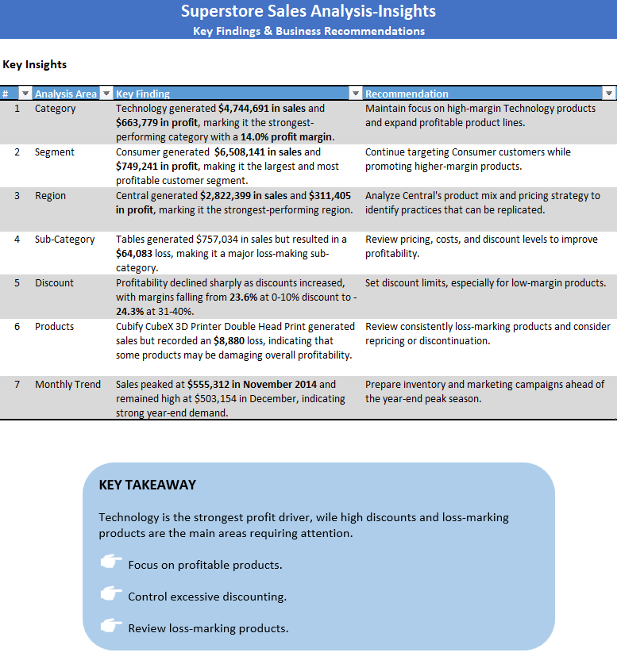

# SuperStore Orders | Sales Performance Analysis

## Project Overview

This project analyzes SuperStore sales data to evaluate business performance, identify profitable product categories, understand customer segments, and uncover areas of potential profit loss using Microsoft Excel.

The analysis focuses on sales performance, profitability, product performance, regional trends, customer segments, and discount impact to generate actionable business insights and recommendations.

## Dashboard Preview


## Business Objectives

- Evaluate overall sales and profitability performance.
- Identify top-performing product categories and products.
- Analyze sales and profit across customer segments and regions.
- Understand the relationship between discounts and profitability.
- Identify loss-making products and sub-categories.
- Develop data-driven business recommendations.

## Dataset

- **Dataset Name:** Global Superstore Dataset
- **Source:** [Kaggle – Global Superstore](https://www.kaggle.com/)
- **Original Records:** 51,290
- **File Format:** CSV (.csv)

## Tools & Skills

**Microsoft Excel**

- Data Cleaning & Preparation
- Excel Formulas & Functions
- PivotTables & PivotCharts
- Data Analysis
- KPI Development
- Interactive Dashboard & Slicers
- Business Insights & Recommendations

## Project Structure

```text
SuperStoreOrders_Excel_Analysis/
│
├── README.md
│
├── Global Superstore Dataset.csv
│
├── SuperStoreOrders_Analysis.xlsx
│
├── Dashboard.png
│
└── Business_Insights.png
```

## Analysis Workflow

**1. Data Preparation**
- Reviewed the raw dataset and checked data consistency.
- Prepared and cleaned data for analysis.
- Created additional calculated fields for analysis, including Year, Month, Shipping Days, Discount, and Profit Margin.

**2. Exploratory Data Analysis**
- Analyzed sales and profit by category and sub-category.
- Evaluated performance across customer segments and regions.
- Identified top 5 products by sales and profit.
- Examined discount levels and their relationship with profitability.
- Analyzed sales trends over time.

**3. Dashboard Development**
- Created KPI summaries for overall business performance.
- Built interactive PivotCharts.
- Added Slicers to filter data by Category, Month, Region, Segment, and Year.

**4. Business Insights & Recommendations**
- Summarized key findings.
- Identified profitable and loss-making areas.
- Developed recommendations to support business decisions.

## Key Performance Indicators

| Metric | Value |
|---|---:|
| Total Sales | $12,642,905 |
| Total Profit | $1,469,035 |
| Total Orders | 25,035 |
| Average Order Value | $505.01 |
| Profit Margin | 11.62% |

## Key Business Insights



## Key Takeaways

This project demonstrates the ability to use Microsoft Excel for end-to-end sales analysis, from data preparation and exploratory analysis to interactive dashboard development and business recommendations.

The findings highlight the importance of evaluating both sales and profitability rather than relying on revenue alone.

---

**Project Type:** Data Analytics Portfolio

**Tools:** Microsoft Excel

**Focus Areas:** Sales Analysis | Profitability Analysis | Product Performance | Customer Segmentation | Business Insights

## 👤 Author

**Chanakan Angyan**

Bachelor of Science in Computer Science

Aspiring **Data Analyst** with an interest in data analysis, business intelligence, and data visualization.


**GitHub:** https://github.com/Chanakan-Angyan

**LinkedIn:** linkedin.com/in/chanakan-angyan-a2596742a